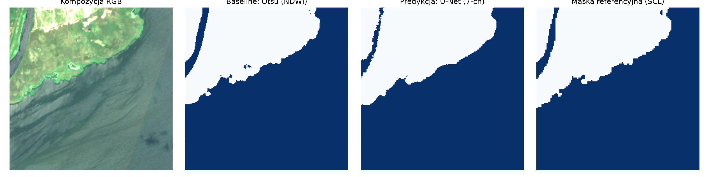

# Sentinel-2 Surface Water Segmentation & Otsu Baseline Analysis

Deep learning pipeline segmenting surface water bodies from Sentinel-2 Level-2A multispectral imagery using a U-Net architecture with a ResNet-34 backbone. The project includes a comparative study benchmarking the 7-channel deep learning model against classical adaptive Otsu thresholding on the Normalized Difference Water Index (NDWI).

## Overview & Remote Sensing Motivation

Broad-band optical and near-infrared reflectance over inland and coastal waters is susceptible to high turbidity, sediment plumes, submerged vegetation, and cloud shadows. Standard index thresholding methods often produce false negatives across complex shorelines. This project investigates whether a multispectral convolutional network combining native 10 m bands, resampled SWIR, and non-linear water indices can suppress radiometric noise and recover clean shoreline geometry from lower-resolution reference data.

## Dataset & Features

Sentinel-2 L2A scene `S2B_MSIL2A_20230610T101609_R065_T33UVV` (Szczecin Lagoon, cloud cover < 5%) queried via Planetary Computer STAC API. A 2239 x 1994 px spatial crop was tiled into non-overlapping 256 x 256 px patches filtered for water presence (2–98% water pixels per tile) and partitioned into 15 training and 4 validation tiles. Ground truth labels were derived from the Sen2Cor Scene Classification Layer (SCL class 6).

Input feature vectors (7 channels):

- Optical & NIR bands: B02 (490 nm, 10 m), B03 (560 nm, 10 m), B04 (665 nm, 10 m), B08 (842 nm, 10 m)
- Short-Wave Infrared: B11 (1610 nm, 20 m bilinearly resampled to 10 m)
- Spectral indices: `NDWI = (B03 - B08) / (B03 + B08)` and `MNDWI = (B03 - B11) / (B03 + B11)`
- Radiometric calibration: Processing Baseline 04.00 offset correction (DN - 1000), scaled to BOA reflectance in the range 0–1

## Results & Comparative Evaluation

Trained over 25 epochs using compound loss (0.5 × BCE + 0.5 × Dice) and AdamW optimizer (learning rate 1e-4, weight decay 1e-4). Metrics are global (pixels pooled across all validation tiles):

| Method | IoU | Dice |
|---|---|---|
| Otsu threshold on NDWI (baseline) | 0.9851 | 0.9925 |
| U-Net, ResNet-34, 7 channels | 0.9855 | 0.9927 |

On this scene the two methods are practically tied: the 0.0004 IoU gap is well within the noise of a 4-tile validation set. Clear, cloud-free summer water is an easy case, and a simple NDWI threshold already handles it well.

The differences are qualitative (see the figure below):
- Spatial continuity: Otsu leaves small false-negative clusters in open water where the spectral signal varies (e.g. phytoplankton, shallow bottom). U-Net produces continuous water bodies.
- Shoreline shape: the SCL reference mask is derived at 20 m and shows blocky edges at 10 m. U-Net predictions look visually smoother and follow the RGB shoreline more closely. This is a visual observation only; the metrics are computed against the blocky SCL mask and cannot confirm it.

## Limitations

- Single scene, 19 tiles (15 train / 4 validation). The results are a proof of concept, not a general performance estimate.
- Tiles are split randomly within one scene, so neighbouring tiles of the same water body can appear in both sets (spatial leakage).
- No separate test set: the checkpoint is selected and reported on the same validation tiles.
- Labels come from the Sen2Cor SCL layer, which is itself a classifier output. The model learns to reproduce SCL, not independently verified water extent.
- Tiles with less than 2% or more than 98% water are excluded, which removes the hardest and the most trivial cases.

## Visual Comparison



## Full Report

A complete technical report in Polish is available in this repository (`Sentinel-2_U-Net.docx`).

## Setup & Run

```bash
pip install -r requirements.txt
python src/download_data.py
python src/train.py
python src/evaluate.py
```
