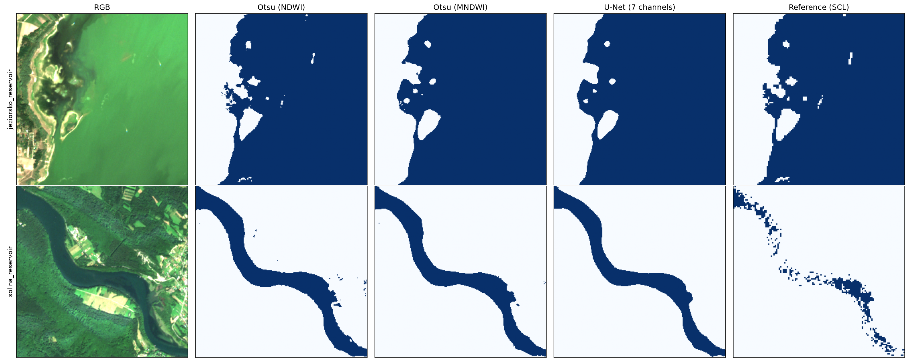

# Sentinel-2 Surface Water Segmentation: U-Net vs Otsu Baselines

Segmentation of surface water in Sentinel-2 Level-2A imagery with a U-Net (ResNet-34 encoder) trained on 7 input channels, benchmarked against classical Otsu thresholds on NDWI and MNDWI. The model is evaluated on water bodies it never saw during training, including a mountain reservoir where the reference labels miss part of the water surface.

## Data

Imagery is queried from the Microsoft Planetary Computer STAC API (`sentinel-2-l2a`, summer 2023, least cloudy scene per area, all used scenes have 0–0.1% cloud cover). Each area is cut into non-overlapping 256 x 256 px tiles at 10 m resolution.

Every area goes entirely into one split, so the same water body never appears in both training and evaluation:

| Split | Area | Tiles |
|---|---|---|
| train | Szczecin Lagoon | 21 |
| train | Lake Śniardwy | 27 |
| train | Vistula Lagoon | 14 |
| train | Włocławek Reservoir | 11 |
| val | Lake Gopło | 12 |
| test | Jeziorsko Reservoir | 10 |
| test | Solina Reservoir (mountain valley) | 8 |

Tiles are kept only if they contain 2–98% water and less than 5% invalid pixels (no data, clouds, cloud shadows, cirrus).

**Labels** come from the Sen2Cor Scene Classification Layer (SCL class 6 = water), resampled from 20 m to 10 m with nearest neighbour. SCL is available for every scene for free, but it is a classification product, not verified ground truth (see Discussion).

**Input channels (7):**
- B02, B03, B04, B08 (10 m)
- B11 (SWIR, 20 m, bilinearly resampled to 10 m)
- `NDWI = (B03 - B08) / (B03 + B08)`
- `MNDWI = (B03 - B11) / (B03 + B11)`

Reflectance is corrected for the processing baseline 04.00+ offset (DN - 1000, read from scene metadata) and scaled to the range 0–1. The crop window is aligned to the 20 m grid, so the 10 m bands, B11 and the SCL labels cover exactly the same pixels.

## Training

- U-Net with ResNet-34 encoder (ImageNet weights), via `segmentation-models-pytorch`
- Loss: 0.5 × BCE + 0.5 × Dice
- AdamW, learning rate 1e-4, weight decay 1e-4, batch size 4, 25 epochs
- Augmentations: random horizontal/vertical flips and 90° rotations (geometric only, spectral values unchanged)
- Fixed random seeds; checkpoint selected by validation IoU
- Trained on CPU

## Results (test set)

Metrics are computed globally over all pixels of each area. Both baselines apply Otsu's threshold to a water index separately for each tile: NDWI (green/NIR) and MNDWI (green/SWIR). The MNDWI baseline uses the same SWIR information as U-Net, which makes the comparison fairer.

| Area | Method | IoU | Dice | Precision | Recall |
|---|---|---|---|---|---|
| Jeziorsko | Otsu (NDWI) | **0.956** | **0.978** | **0.962** | 0.994 |
| Jeziorsko | Otsu (MNDWI) | 0.943 | 0.971 | 0.947 | 0.996 |
| Jeziorsko | U-Net | 0.944 | 0.971 | 0.946 | 0.997 |
| Solina | Otsu (NDWI) | 0.833 | 0.909 | 0.833 | 1.000 |
| Solina | Otsu (MNDWI) | 0.873 | 0.932 | 0.876 | 0.996 |
| Solina | U-Net | **0.891** | **0.942** | **0.901** | 0.987 |
| **All test tiles** | Otsu (NDWI) | 0.913 | 0.954 | 0.917 | 0.996 |
| **All test tiles** | Otsu (MNDWI) | 0.920 | 0.958 | 0.923 | 0.996 |
| **All test tiles** | U-Net | **0.926** | **0.962** | **0.932** | 0.994 |



Full per-area metrics: [`outputs/tables/metrics_test.csv`](./outputs/tables/metrics_test.csv)

## Discussion

**U-Net vs index thresholds:** U-Net has the highest overall IoU, but the margin over the stronger baseline (Otsu on MNDWI) is only 0.006 (0.926 vs 0.920), which is below what this test set can reliably resolve. On clear summer imagery, a simple, unsupervised threshold on a water index gets very close to a trained deep learning model and is worth checking first.

**Lowland reservoir (Jeziorsko):** Otsu on NDWI matches the reference best. U-Net and Otsu on MNDWI produce smoother shorelines and miss some small shoreline details present in SCL. SCL itself relies largely on spectral thresholds, so an NDWI threshold may agree with it partly by construction.

**Mountain reservoir (Solina):** in a narrow, shaded arm of the reservoir the SCL reference marks only fragments of the water surface (about 5% of the tile), while the RGB image and all three methods show a continuous water body (about 14% of the tile). On the remaining Solina tiles the disagreement is much smaller: a 2–5% band of pixels, mostly along the shoreline, with on average positive MNDWI values, which SCL does not label as water. Part of the lower precision in Solina therefore comes from the reference, not from the predictions.

U-Net agrees most closely with SCL in Solina. Without an independent reference it is not possible to tell whether this means better segmentation or that the model has learned to reproduce SCL's behaviour.

This shows the main weakness of using SCL as ground truth: in difficult conditions (terrain shadows, shorelines) the metrics partly measure agreement with Sen2Cor rather than correctness.

## Limitations

- **Reference labels:** SCL is a classifier output, not verified ground truth. It is used for both training and evaluation, so the model partly learns to reproduce SCL behaviour, including its errors. An independent reference (e.g. ESA WorldCover or manual annotation) would make the test results more reliable.
- **Small test set and single run:** two reservoirs (18 tiles) and one training run, with no estimate of variance across seeds. Differences below about 0.01 IoU should not be treated as meaningful.
- **Shared acquisition dates:** several areas (including the Jeziorsko test reservoir and three training/validation areas) come from the same Sentinel-2 overpass on 15 August 2023, so they share atmospheric and illumination conditions.
- **Single season:** all scenes are from summer 2023 with almost no clouds. Winter, ice, turbid water and cloudy conditions are not covered.
- **Tile filter:** tiles with less than 2% or more than 98% water are excluded, which removes both the hardest and the most trivial cases.
- **Invalid pixels:** tiles may contain up to 5% pixels flagged by SCL as clouds, cloud shadows or no data. They are treated as non-water in training and evaluation. With 0–0.1% scene cloud cover the effect is negligible, but they are not masked out.
- **Checkpoint selection:** the best model is chosen by IoU on a single validation lake (12 tiles), which is a noisy criterion.

## Project structure

```
src/
  download_data.py   # STAC query, band reading, offset correction, tiling into train/val/test
  indices.py         # NDWI, MNDWI and 7-channel stacking
  dataset.py         # PyTorch Dataset
  model.py           # U-Net definition
  train.py           # training loop with augmentations
  evaluate.py        # U-Net vs Otsu (NDWI, MNDWI) on the test set, per-area metrics and figure
```

## Setup & Run

Tested with Python 3.13.

```bash
pip install -r requirements.txt
python src/download_data.py
python src/train.py
python src/evaluate.py
```

## Data source

Contains modified Copernicus Sentinel-2 data (2023), processed by ESA, accessed via Microsoft Planetary Computer.
